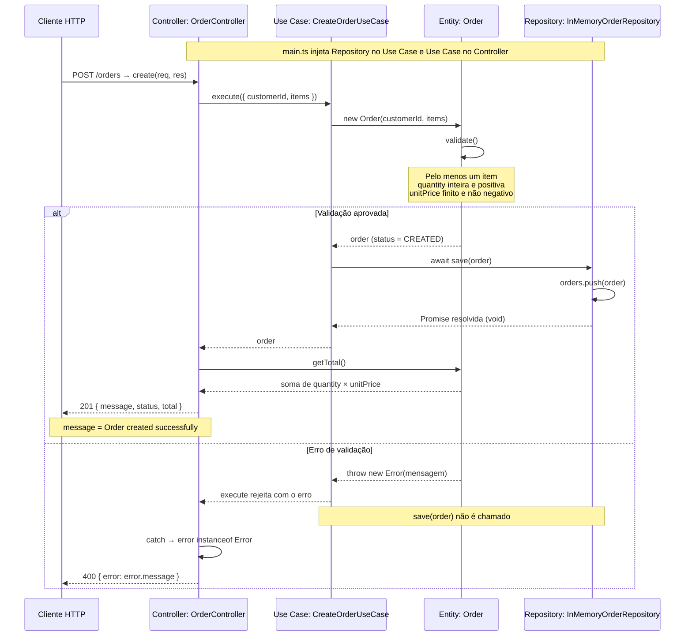

# POST /orders — diagrama de sequência

Análise da implementação atual em `src/`. O código da API não foi alterado.

## Regras e mensagens de validação

| Condição inválida | Mensagem |
| --- | --- |
| `items.length === 0` | `Order must have at least one item` |
| `quantity` não inteira ou menor ou igual a zero | `Quantity must be greater than zero` |
| `unitPrice` não finito ou negativo | `Unit price cannot be negative` |

As regras são executadas nessa ordem; a primeira falha interrompe a construção de `Order`.

## Observações da implementação

- A rota usa `express.json()` e encaminha a requisição para `OrderController.create()`.
- O Use Case depende do contrato `OrderRepository`; `main.ts` fornece `InMemoryOrderRepository`, que salva em um array em memória.
- O Controller calcula o total após o salvamento, ao montar a resposta.
- Qualquer valor capturado que seja uma instância de `Error` resulta em HTTP 400, inclusive erros que não sejam de validação. Outros valores lançados resultam em HTTP 500 com `Internal server error`.
- Não há validação explícita de `customerId`, `productId` ou da estrutura completa do corpo em tempo de execução. As regras acima pressupõem a estrutura esperada de `items`.

## Arquivos analisados

- `src/main.ts`
- `src/interfaces/http/controllers/OrderController.ts`
- `src/application/useCases/CreateOrderUseCase.ts`
- `src/domain/entities/Order.ts`
- `src/application/repositories/OrderRepository.ts`
- `src/infra/repositories/InMemoryOrderRepository.ts`

O desenho no tldraw não foi inserido porque o painel do quadro não conectou durante a tentativa. Este documento contém o diagrama em Mermaid.
