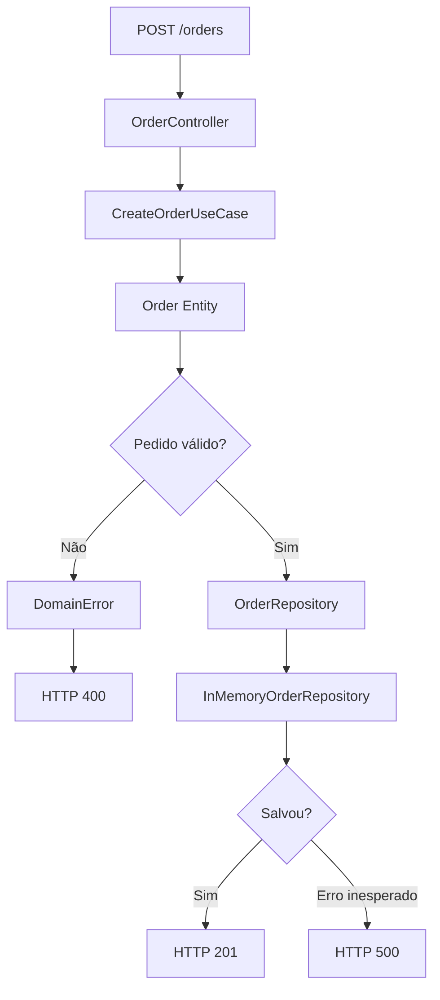

# Clean Architecture — Aula 3: API e Tratamento de Erros

## Objetivo

Construir uma API de pedidos com Node.js, TypeScript e Express, aplicando os princípios da Clean Architecture.

Conceitos estudados:

- Entidades e regras de negócio
- Casos de uso
- Interfaces e contratos
- Repositórios e infraestrutura
- Inversão de dependência
- Controllers HTTP
- Tratamento de erros de domínio e infraestrutura

## 1. Estrutura do projeto

```text
src/
├── domain/
│   ├── entities/
│   │   └── Order.ts
│   └── errors/
│       └── DomainError.ts
├── application/
│   ├── repositories/
│   │   └── OrderRepository.ts
│   └── useCases/
│       └── CreateOrderUseCase.ts
├── infra/
│   └── repositories/
│       └── InMemoryOrderRepository.ts
├── interfaces/
│   └── http/
│       └── controllers/
│           └── OrderController.ts
└── main.ts
```

## 2. Entity — Order

A entidade representa um conceito do domínio e protege suas regras de negócio.

Arquivo: `src/domain/entities/Order.ts`

```typescript
import { DomainError } from "../errors/DomainError";

export type OrderItem = {
  productId: number;
  quantity: number;
  unitPrice: number;
};

export class Order {
  readonly status = "CREATED";

  constructor(
    public readonly customerId: number,
    public readonly items: OrderItem[]
  ) {
    this.validate();
  }

  private validate(): void {
    if (!this.items?.length) {
      throw new DomainError("Order must have items");
    }

    for (const item of this.items) {
      if (!Number.isInteger(item.quantity) || item.quantity <= 0) {
        throw new DomainError("Quantity must be greater than zero");
      }

      if (!Number.isFinite(item.unitPrice) || item.unitPrice < 0) {
        throw new DomainError("Invalid unit price");
      }
    }
  }

  getTotal(): number {
    return this.items.reduce(
      (total, item) => total + item.quantity * item.unitPrice,
      0
    );
  }
}
```

**Aprendizado:** as regras de validade do pedido pertencem à entidade, não ao Controller ou ao banco de dados.

## 3. DomainError

Arquivo: `src/domain/errors/DomainError.ts`

```typescript
export class DomainError extends Error {
  constructor(message: string) {
    super(message);
    this.name = "DomainError";
  }
}
```

O `DomainError` permite distinguir uma violação de regra de negócio de uma falha inesperada.

## 4. Interface — OrderRepository

Arquivo: `src/application/repositories/OrderRepository.ts`

```typescript
import { Order } from "../../domain/entities/Order";

export interface OrderRepository {
  save(order: Order): Promise<void>;
}
```

A interface define **o que** deve ser implementado, mas não **como**.

Não devemos colocar uma implementação `async save() { ... }` dentro de uma interface TypeScript.

## 5. Repositório em memória

Arquivo: `src/infra/repositories/InMemoryOrderRepository.ts`

```typescript
import { Order } from "../../domain/entities/Order";
import { OrderRepository } from "../../application/repositories/OrderRepository";

export class InMemoryOrderRepository implements OrderRepository {
  private orders: Order[] = [];

  async save(order: Order): Promise<void> {
    this.orders.push(order);
  }
}
```

Essa implementação armazena pedidos temporariamente em um array.

Posteriormente, podemos substituí-la por uma implementação PostgreSQL ou Oracle sem modificar o contrato.

## 6. Use Case — CreateOrderUseCase

Arquivo: `src/application/useCases/CreateOrderUseCase.ts`

```typescript
import { Order, OrderItem } from "../../domain/entities/Order";
import { OrderRepository } from "../repositories/OrderRepository";

type CreateOrderInput = {
  customerId: number;
  items: OrderItem[];
};

export class CreateOrderUseCase {
  constructor(
    private readonly orderRepository: OrderRepository
  ) {}

  async execute(input: CreateOrderInput): Promise<Order> {
    const order = new Order(input.customerId, input.items);

    await this.orderRepository.save(order);

    return order;
  }
}
```

Responsabilidades:

1. Receber os dados da operação.
2. Criar a entidade `Order`.
3. Solicitar a persistência pelo contrato `OrderRepository`.
4. Retornar o pedido criado.

O Use Case não precisa conhecer Express, PostgreSQL ou detalhes de infraestrutura.

## 7. Controller HTTP

Arquivo: `src/interfaces/http/controllers/OrderController.ts`

```typescript
import { Request, Response } from "express";
import { CreateOrderUseCase } from "../../../application/useCases/CreateOrderUseCase";
import { DomainError } from "../../../domain/errors/DomainError";

export class OrderController {
  constructor(
    private readonly createOrderUseCase: CreateOrderUseCase
  ) {}

  async create(req: Request, res: Response): Promise<void> {
    try {
      const { customerId, items } = req.body;

      const order = await this.createOrderUseCase.execute({
        customerId,
        items
      });

      res.status(201).json({
        message: "Order created successfully",
        status: order.status,
        total: order.getTotal()
      });
    } catch (error) {
      if (error instanceof DomainError) {
        res.status(400).json({ error: error.message });
        return;
      }

      console.error("Unexpected error:", error);

      res.status(500).json({
        error: "Internal server error"
      });
    }
  }
}
```

O Controller traduz a requisição HTTP para uma chamada ao Use Case e transforma o resultado ou erro em resposta HTTP.

## 8. Composição das dependências

Arquivo: `src/main.ts`

```typescript
import express from "express";
import { InMemoryOrderRepository } from "./infra/repositories/InMemoryOrderRepository";
import { CreateOrderUseCase } from "./application/useCases/CreateOrderUseCase";
import { OrderController } from "./interfaces/http/controllers/OrderController";

const app = express();
app.use(express.json());

const repository = new InMemoryOrderRepository();
const useCase = new CreateOrderUseCase(repository);
const controller = new OrderController(useCase);

app.post("/orders", (req, res) => {
  void controller.create(req, res);
});

app.listen(3000, () => {
  console.log("Server running on port 3000");
});
```

O `main.ts` conecta as implementações concretas aos componentes que dependem das abstrações.

> Nota: o exemplo utiliza tratamento de erros no próprio Controller. Em aplicações maiores, podemos centralizar esse tratamento em middleware do Express.

## 9. Fluxo da requisição



## 10. Testes realizados no Postman

### Pedido válido — HTTP 201

```json
{
  "customerId": 123,
  "items": [
    {
      "productId": 100,
      "quantity": 2,
      "unitPrice": 25
    }
  ]
}
```

Resposta:

```json
{
  "message": "Order created successfully",
  "status": "CREATED",
  "total": 50
}
```

### Quantidade inválida — HTTP 400

Ao enviar `quantity: 0`:

```json
{
  "error": "Quantity must be greater than zero"
}
```

### Falha de infraestrutura — HTTP 500

Para simular uma falha, substituímos temporariamente o método `save()` por:

```typescript
async save(order: Order): Promise<void> {
  throw new Error("Database connection failed");
}
```

Resposta:

```json
{
  "error": "Internal server error"
}
```

**Importante:** após o teste, restaurar o método original com `this.orders.push(order)`.

## 11. Erros encontrados durante o desenvolvimento

### ReferenceError: DomainError is not defined

Causa: utilização de `DomainError` no `instanceof` sem um import válido em tempo de execução.

Correção:

```typescript
import { DomainError } from "../../../domain/errors/DomainError";
```

A instrução `instanceof` precisa da classe disponível em tempo de execução.

### Implementação dentro de interface

Tentativa incorreta:

```typescript
export interface OrderRepository {
  async save(order: Order): Promise<void> {
    throw new Error("Database connection failed");
  }
}
```

Correção: manter somente a assinatura na interface e implementar o comportamento na classe concreta.

### Postman: Could not get response

Um erro dentro do próprio `catch` causou uma rejeição não tratada, encerrando o processo Node.js.

Aprendizado: o código responsável por tratar exceções também pode apresentar falhas.

## 12. Princípio da inversão de dependência

O `CreateOrderUseCase` depende da interface `OrderRepository`, não de uma implementação específica.

Isso permite trocar:

- `InMemoryOrderRepository`
- `PostgresOrderRepository`
- `OracleOrderRepository`

Sem alterar o caso de uso, desde que as implementações respeitem o contrato.

**Atenção:** baixo acoplamento não significa ausência de dependências. Significa depender de contratos estáveis em vez de detalhes concretos.

## 13. Erros de negócio x infraestrutura

| Situação | Erro | HTTP |
|---|---|---|
| Quantidade inválida | `DomainError` | 400 |
| Falha inesperada de persistência | `Error` | 500 |
| Pedido criado | Nenhum | 201 |

O código HTTP é definido pelo tratamento na camada HTTP, não automaticamente pelo local onde o `throw` ocorreu.

Nem todo erro de domínio precisa ser HTTP 400. O mapeamento depende do contrato da API.

## 14. Principais aprendizados

- Entidades protegem invariantes do domínio.
- Use Cases coordenam operações da aplicação.
- Interfaces estabelecem contratos.
- Repositórios concretos pertencem à infraestrutura.
- Controllers lidam com entrada e saída HTTP.
- Injeção de dependência reduz acoplamento.
- Erros de negócio e falhas inesperadas precisam ser diferenciados.
- É possível substituir a infraestrutura sem reescrever o caso de uso.

## 15. Próxima etapa — Aula 3.7

Testes unitários com Jest.

Objetivos:

- Testar `CreateOrderUseCase` isoladamente.
- Utilizar mocks do `OrderRepository`.
- Validar pedidos corretos e incorretos.
- Simular falhas na persistência.
- Executar testes sem iniciar o Express.
- Compreender a diferença entre testes unitários e de integração.

---

**Status:** Aula 3.6 concluída — próxima etapa: Jest.
