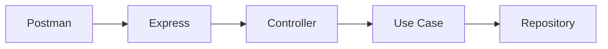
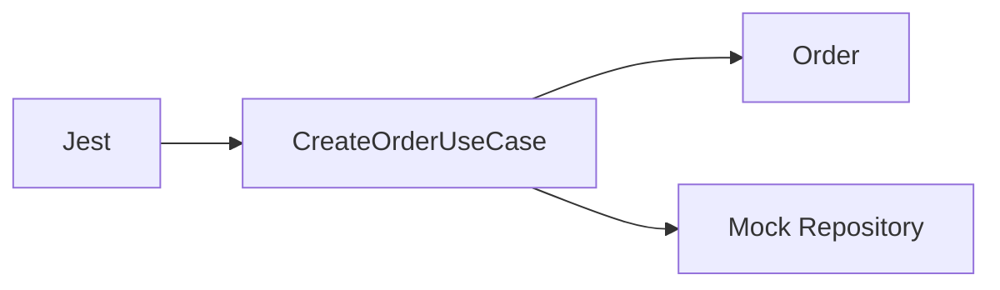
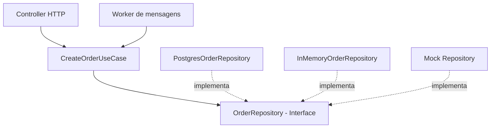

# Clean Architecture — Aula 3.7
## Testes Unitários com Jest e TypeScript

**Projeto:** Arquitetura de Software  
**Tecnologias:** Node.js, TypeScript, Jest, Express  
**Status:** Concluído — 3 testes aprovados

---

## 1. Objetivo da aula

Aprender a testar casos de uso de forma isolada, sem depender de:

- Servidor HTTP (Express)
- Postman
- Banco de dados
- Serviços externos

O objetivo é garantir que as regras da aplicação funcionem corretamente e que falhas sejam tratadas de maneira previsível.

## 2. O que é um teste unitário?

Um teste unitário verifica o comportamento de uma pequena unidade do software.

Nesta aula, a unidade testada foi o `CreateOrderUseCase`.

Ao utilizar um repositório simulado, conseguimos testar o caso de uso sem executar uma implementação real de persistência.

### Teste manual pela API



### Teste unitário com Jest



O segundo fluxo é mais isolado e não precisa de servidor ou banco de dados.

---

## 3. Instalação e configuração

Instalamos as dependências:

```bash
npm install -D jest ts-jest @types/jest
```

Geramos a configuração inicial:

```bash
npx ts-jest config:init
```

Configuramos o script no `package.json`:

```json
{
  "scripts": {
    "test": "jest"
  }
}
```

Executamos os testes com:

```bash
npm test
```

---

## 4. O que é um Mock?

Um mock é um objeto ou função simulada que substitui uma dependência durante um teste.

Nosso caso de uso depende do contrato:

```typescript
export interface OrderRepository {
  save(order: Order): Promise<void>;
}
```

No teste, fornecemos uma implementação simulada:

```typescript
const repository: OrderRepository = {
  save: jest.fn().mockResolvedValue(undefined)
};
```

Isso permite controlar o comportamento do método `save()`.

### Benefícios

- Isolamento das dependências
- Execução rápida
- Simulação de erros
- Verificação das chamadas realizadas
- Independência de infraestrutura

A possibilidade de substituir o repositório por um mock é consequência da inversão de dependência aplicada ao projeto.

---

## 5. Estrutura dos arquivos

```text
src/
├── domain/
│   ├── entities/
│   │   └── Order.ts
│   └── errors/
│       └── DomainError.ts
├── application/
│   ├── repositories/
│   │   └── OrderRepository.ts
│   └── useCases/
│       ├── CreateOrderUseCase.ts
│       └── CreateOrderUseCase.spec.ts
├── infra/
│   └── repositories/
│       └── InMemoryOrderRepository.ts
├── interfaces/
│   └── http/
│       └── controllers/
│           └── OrderController.ts
└── main.ts
```

---

## 6. Código completo dos testes

Arquivo:

`src/application/useCases/CreateOrderUseCase.spec.ts`

```typescript
import { CreateOrderUseCase } from "./CreateOrderUseCase";
import { OrderRepository } from "../repositories/OrderRepository";

describe("CreateOrderUseCase", () => {

  it("should create an order successfully", async () => {
    const repository: OrderRepository = {
      save: jest.fn().mockResolvedValue(undefined)
    };

    const useCase = new CreateOrderUseCase(repository);

    const order = await useCase.execute({
      customerId: 123,
      items: [
        {
          productId: 100,
          quantity: 2,
          unitPrice: 25
        }
      ]
    });

    expect(order.status).toBe("CREATED");
    expect(order.getTotal()).toBe(50);
    expect(repository.save).toHaveBeenCalledTimes(1);
    expect(repository.save).toHaveBeenCalledWith(order);
  });

  it("should reject an order with invalid quantity", async () => {
    const repository: OrderRepository = {
      save: jest.fn().mockResolvedValue(undefined)
    };

    const useCase = new CreateOrderUseCase(repository);

    await expect(
      useCase.execute({
        customerId: 123,
        items: [
          {
            productId: 100,
            quantity: 0,
            unitPrice: 25
          }
        ]
      })
    ).rejects.toThrow(
      "Quantity must be greater than zero"
    );

    expect(repository.save).not.toHaveBeenCalled();
  });

  it("should propagate repository errors", async () => {
    const repository: OrderRepository = {
      save: jest.fn().mockRejectedValue(
        new Error("Database connection failed")
      )
    };

    const useCase = new CreateOrderUseCase(repository);

    await expect(
      useCase.execute({
        customerId: 123,
        items: [
          {
            productId: 100,
            quantity: 2,
            unitPrice: 25
          }
        ]
      })
    ).rejects.toThrow("Database connection failed");

    expect(repository.save).toHaveBeenCalledTimes(1);
  });

});
```

---

## 7. Teste 1 — Pedido válido

**Objetivo:** garantir que o caso de uso crie um pedido corretamente.

Entrada:

- Cliente: 123
- Produto: 100
- Quantidade: 2
- Preço unitário: 25

Resultado esperado:

- Status `CREATED`
- Total de 50
- Repositório chamado uma vez
- Repositório recebe a entidade criada

### Assertions

```typescript
expect(order.status).toBe("CREATED");
expect(order.getTotal()).toBe(50);
expect(repository.save).toHaveBeenCalledTimes(1);
expect(repository.save).toHaveBeenCalledWith(order);
```

O método `expect()` define uma expectativa sobre o comportamento observado.

---

## 8. Teste 2 — Quantidade inválida

**Objetivo:** garantir que pedidos inválidos sejam rejeitados.

Entrada:

```typescript
{
  productId: 100,
  quantity: 0,
  unitPrice: 25
}
```

Resultado esperado:

```text
Quantity must be greater than zero
```

Verificações:

```typescript
await expect(
  useCase.execute(input)
).rejects.toThrow(
  "Quantity must be greater than zero"
);

expect(repository.save).not.toHaveBeenCalled();
```

### Aprendizado

A entidade `Order` é responsável por proteger suas regras de negócio.

Um pedido inválido não deve ser persistido.

Por isso, verificamos tanto a rejeição da operação quanto a ausência de chamada ao método `save()`.

---

## 9. Teste 3 — Falha de infraestrutura

**Objetivo:** simular uma falha no repositório e verificar sua propagação.

Mock utilizado:

```typescript
const repository: OrderRepository = {
  save: jest.fn().mockRejectedValue(
    new Error("Database connection failed")
  )
};
```

Resultado esperado:

```text
Database connection failed
```

### Aprendizado

O `CreateOrderUseCase` não transforma diretamente a falha em HTTP 500.

Ele propaga o erro porque não possui uma estratégia específica para resolvê-lo.

A camada HTTP é responsável por transformar essa falha em uma resposta adequada ao cliente.

---

## 10. Principais recursos do Jest

| Recurso | Finalidade |
|---|---|
| `describe()` | Agrupar testes |
| `it()` | Definir um cenário |
| `expect()` | Declarar uma expectativa |
| `jest.fn()` | Criar uma função simulada |
| `mockResolvedValue()` | Simular sucesso assíncrono |
| `mockRejectedValue()` | Simular falha assíncrona |
| `toBe()` | Comparar valores primitivos |
| `toHaveBeenCalledTimes()` | Verificar quantidade de chamadas |
| `toHaveBeenCalledWith()` | Verificar argumentos |
| `not.toHaveBeenCalled()` | Garantir que não houve chamada |
| `rejects.toThrow()` | Verificar rejeição com erro |

---

## 11. Separação de responsabilidades

O caso de uso deve permanecer independente da tecnologia de entrada.

Exemplo de arquitetura:



### Por que não usar `res.status(500)` dentro do Use Case?

Porque isso criaria dependência direta da tecnologia HTTP.

Se amanhã o caso de uso for chamado por:

- Uma API REST
- Um consumidor de mensagens
- Um job agendado
- Um comando de terminal

Ele deverá continuar funcionando.

O Use Case deve conhecer as regras da aplicação, não os detalhes do mecanismo que o executa.

---

## 12. Resultado da execução

Comando:

```bash
npm test
```

Resultado obtido:

```text
PASS src/application/useCases/CreateOrderUseCase.spec.ts

CreateOrderUseCase
  ✓ should create an order successfully
  ✓ should reject an order with invalid quantity
  ✓ should propagate repository errors

Test Suites: 1 passed, 1 total
Tests:       3 passed, 3 total
```

Todos os cenários foram aprovados.

---

## 13. Principais aprendizados

1. Testes unitários permitem validar o comportamento da aplicação de maneira automatizada.
2. Mocks permitem isolar dependências externas.
3. A interface `OrderRepository` facilita a substituição da infraestrutura.
4. A entidade deve impedir a persistência de dados inválidos.
5. Erros inesperados podem ser simulados sem modificar o código de produção.
6. O Use Case não deve depender diretamente de Express ou de códigos HTTP.
7. A inversão de dependência melhora a testabilidade e reduz o acoplamento.

## 14. Reflexão de arquitetura

**Pergunta:** por que não utilizar `res.status(500)` diretamente dentro do `CreateOrderUseCase`?

**Resposta:** porque isso acoplaria o caso de uso ao protocolo HTTP e à tecnologia Express.

A aplicação deve ser organizada em torno de suas regras e contratos, permitindo trocar detalhes técnicos sem modificar o núcleo da solução.

## 15. Próximos passos

**Aula 4 — Estrutura de pastas e organização da arquitetura**

Estudar:

- Responsabilidade de cada camada
- Direção das dependências
- Violações comuns da Clean Architecture
- Organização por funcionalidades
- Evolução do projeto conforme aumenta sua complexidade

---

**Conclusão:** a implementação do `CreateOrderUseCase` foi validada por três testes unitários automatizados, demonstrando isolamento, testabilidade e baixo acoplamento.
